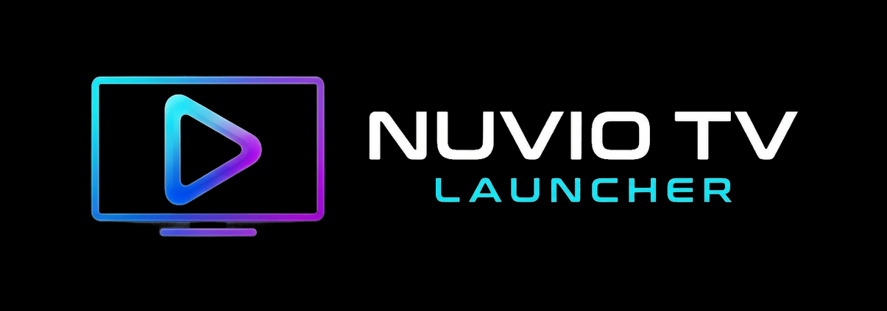

<div align="center">

  

# Nuvio TV Launcher

**Nuvio TV as a real Android TV home screen: your apps, your remote buttons, and your Nuvio library in one launcher for Google TV, Android TV and Fire TV.**

[](https://github.com/Br0ck25/TV-Launcher/releases/latest)
[](https://github.com/Br0ck25/TV-Launcher/releases)
[](https://github.com/Br0ck25/TV-Launcher/releases)
[](LICENSE)
[](https://github.com/NuvioMedia/NuvioTV)

[Download](#download) · [What it adds](#what-the-launcher-adds) · [Build](#build-from-source) · [Staying in sync with Nuvio TV](#staying-in-sync-with-nuvio-tv)

</div>

## Download

- **[Latest release](https://github.com/Br0ck25/TV-Launcher/releases/latest)**: the stable build.
- **[All releases and betas](https://github.com/Br0ck25/TV-Launcher/releases)**: betas are marked *Pre-release*. Turn on the Beta update channel in Settings → About to be offered them in the app.

Pick the APK for your device:

| Device | APK |
|---|---|
| Most Google TV / Android TV devices | `arm64-v8a` |
| Fire TV (all models), older or budget boxes | `armeabi-v7a` |
| Not sure (works everywhere) | `universal` |

The app id is `com.tv.launcher`, so it installs next to the stock Nuvio TV and keeps its own data.

## What the launcher adds

This repository is a fork of [NuvioMedia/NuvioTV](https://github.com/NuvioMedia/NuvioTV). On top of Nuvio TV it adds:

- **Home app and Home button**: set the app as the TV's Home screen, with an accessibility override and boot receiver for firmware that will not hand Home over. Back never leaves the launcher.
- **Phone setup and on-device ADB setup**: pair from a phone, or let the TV grant itself the permission it needs.
- **Button Mapper**: single, double and long press actions for remote buttons, in the launcher and globally.
- **Apps row and Apps page**: every installed app, with rename, hide (on Home or everywhere), move, and app info.
- **Icon packs**, per-app icon choice from a file manager, and selectable app icons.
- Notifications drawer, top-right clock, bell and settings gear, a first-run setup wizard, and the Tile size and "pill shows profile" layout settings.

See [LAUNCHER_TOUCHPOINTS.md](LAUNCHER_TOUCHPOINTS.md) for which files are new and which Nuvio TV files carry our edits.

## Build from source

```bash
git clone https://github.com/Br0ck25/TV-Launcher.git
cd TV-Launcher
./gradlew :app:assembleFullDebug
```

Built with Kotlin, Jetpack Compose, TV Material 3, and Media3. Development requires Android Studio, a JDK, and the Android SDK.

### Releasing

Bump `launcherVersionName` and `launcherVersionCode` in `app/launcher.gradle.kts` (a suffix such as `0.0.1-beta.1` makes it a pre-release), commit, then run the **Release** workflow from the Actions tab. It needs the `LAUNCHER_KEYSTORE_BASE64`, `LAUNCHER_KEY_ALIAS`, `LAUNCHER_KEY_PASSWORD` and `LAUNCHER_STORE_PASSWORD` secrets, and optionally `LOCAL_PROPERTIES_BASE64` for service keys. Always sign with the same key, or users have to uninstall before they can update.

## Staying in sync with Nuvio TV

Launcher code lives in files of its own; Nuvio TV's files only get one-line hooks (see
[LAUNCHER_TOUCHPOINTS.md](LAUNCHER_TOUCHPOINTS.md)). The **Sync upstream** workflow merges
[NuvioMedia/NuvioTV](https://github.com/NuvioMedia/NuvioTV) `dev` into this repository every six hours. A clean merge is
pushed to `sync/nuviotv` and opened as a pull request; a conflicting merge opens an issue listing the files. Set the
repository variable `SYNC_DIRECT` to `true` to push clean merges straight to the default branch instead. The **Launcher
checks** workflow fails any change that edits a Nuvio TV file that is not on the allowed list.

## Credits

Nuvio TV is by [NuvioMedia](https://github.com/NuvioMedia/NuvioTV). The launcher layer is by [Br0ck25](https://github.com/Br0ck25).

## License

[GNU General Public License v3.0](./LICENSE)
